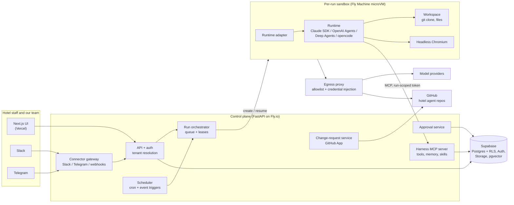
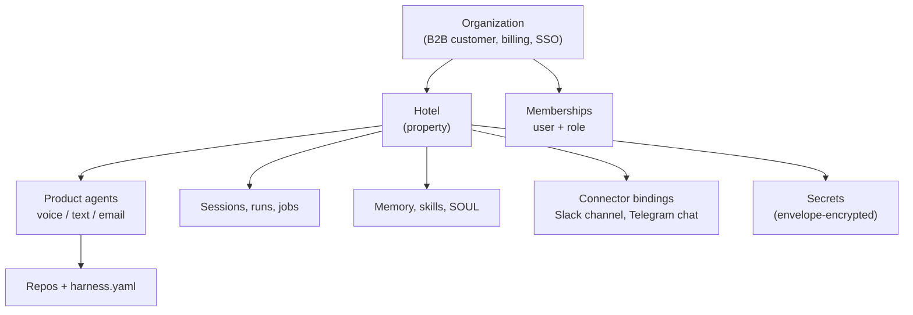
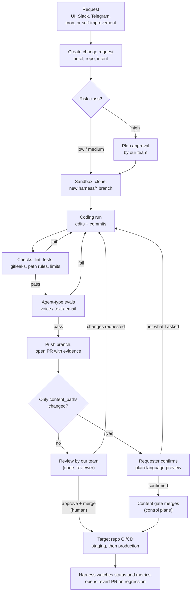
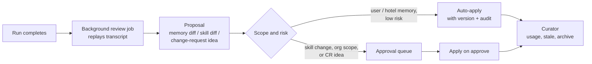

# Hotel Agent Harness — Architecture and Design

| | |
|---|---|
| Status | Draft for review (v0.3: owner answers on the use case applied, see Section 2.4 and Section 14). Nothing here is deployed. |
| Date | 2026-11-18 |
| Scope | Design of the harness, plus the foundations that ship in the same PR |
| Reference system | [Hermes Agent](https://github.com/NousResearch/hermes-agent) (MIT), reviewed at commit `f7e2898a`, 2026-11-17 |

## Contents

1. [Summary](#1-summary)
2. [Goals, non-goals, and terms](#2-goals-non-goals-and-terms)
3. [Key decisions](#3-key-decisions)
4. [System overview](#4-system-overview)
5. [Feature map: Hermes to the harness](#5-feature-map-hermes-to-the-harness)
6. [Agent-runtime adapter layer](#6-agent-runtime-adapter-layer)
7. [Multi-tenancy and isolation (B2B)](#7-multi-tenancy-and-isolation-b2b)
8. [Sandboxing](#8-sandboxing)
9. [Safe changes to hotel voice, text and email agents](#9-safe-changes-to-hotel-voice-text-and-email-agents)
10. [Other subsystems](#10-other-subsystems)
11. [Technology stack and repository layout](#11-technology-stack-and-repository-layout)
12. [Phased milestone plan](#12-phased-milestone-plan)
13. [Risks](#13-risks)
14. [Open questions and answers](#14-open-questions-and-answers)
15. [References](#15-references)

---

## 1. Summary

We build one **harness** that every hotel customer uses. The harness runs an operations-and-coding
agent for each hotel. That agent can:

- build new voice, text, and email agents for the hotel, and change the code of the existing ones;
- send scheduled reports (calls, messages, bookings, agent quality) and do hotel operations in
  the PMS, channel manager, and OTA extranets, API first and browser as a fallback;
- do other day-to-day tasks with skills and tools (browser, files, web, connectors);
- run on a schedule, learn from its work (memory and self-improving skills), and delegate to
  sub-agents;
- talk to staff in a web UI, Slack, and Telegram.

The feature set comes from Hermes Agent. Hermes is a **single-tenant personal agent**: its
state lives in files under `~/.hermes`, and its own security policy says that the only real
boundary against an adversarial model is the operating system. Our harness is **multi-tenant
B2B**. So we keep the Hermes *features* and *learning loop*, but we change three foundations:

1. **State moves to Postgres** (Supabase) and every row carries the tenant (`org_id`, `hotel_id`).
2. **Every agent run executes inside its own sandbox** (a microVM), never in the API process.
3. **The agent framework is pluggable.** One adapter contract covers Claude Agent SDK,
   OpenAI Agents SDK, LangChain Deep Agents, and opencode. Harness features sit above the
   adapter, so they behave the same on every framework.

The day-to-day users are **non-technical hotel staff**. They ask for changes and tasks in plain
language and see plain-language previews and results, never diffs or PRs.

Changes to hotel agents never go straight to production. The harness works on a branch in a
sandbox, runs tests and agent-specific evals, and opens a PR. Then there are two paths:

- **Content changes** (FAQ, hours, rates text, greetings) in paths that the repo's `harness.yaml`
  declares as content: the requester confirms a plain-language before-and-after preview, and the
  control plane's **content gate** merges the PR when all checks and evals pass (D18).
- **All other changes** (code, prompt logic, tools, config): **our team** reviews, approves,
  and merges.

The target repository's own CI/CD deploys after merge. The harness agent itself never holds
merge rights and never deploys. Hotel **operations** that change real systems (rates, inventory,
bookings, campaigns) run only after a hotel staff member approves each action (D19).

The default runtime for the harness agent is the **Claude Agent SDK**, with **opencode** as the
model-agnostic second runtime (D14).

---

## 2. Goals, non-goals, and terms

### 2.1 Goals

- Give each hotel a capable agent with Hermes-level features: skills, tools, memory, sessions,
  scheduling, delegation, browser use, connectors, and self-improvement.
- Let that agent build and change hotel voice, text, and email agents safely, with branches, PRs,
  evals, and human approval (or the content gate for content-only changes).
- Send scheduled reports and do hotel operations in hotel systems, with an approval for every
  action that changes a real system.
- Be usable by non-technical hotel staff from the web app, Slack, and Telegram.
- Support four agent frameworks behind one contract, and add more later without changes to the
  harness core.
- Isolate hotels from each other in data, compute, secrets, connectors, and code access.
- Keep cost, risk, and every action visible and auditable per hotel.

### 2.2 Non-goals (v1)

- The harness agent does not merge PRs, deploy, or run database migrations against live systems.
  The only automatic merge is the control-plane content gate for content-only PRs (D18).
- No desktop app, terminal UI, wake word, or other personal-assistant surfaces from Hermes.
- No model training pipeline (Hermes batch trajectories and trajectory compression). We keep
  transcripts so that we can add this later.
- No marketplace of third-party skills for customers in v1. We curate skills ourselves.

### 2.3 Terms

| Term | Meaning |
|---|---|
| Organization (org) | One B2B customer account, for example a hotel group. The billing and contract unit. |
| Hotel | One property inside an org. Most data, skills, memory, and agents are hotel-scoped. |
| Product agent | A guest- or staff-facing agent that we build for a hotel: voice, text (SMS/WhatsApp/web chat), or email. It lives in its own repository. |
| Harness agent | The operations-and-coding agent that the harness runs for a hotel. It builds and changes product agents and does tasks. |
| Runtime | An agent framework that executes a harness agent turn: Claude Agent SDK, OpenAI Agents SDK, Deep Agents, or opencode. |
| Adapter | Harness code that maps one runtime to the harness contract (`backend/src/harness/runtimes/base.py`). |
| Session | A conversation with a harness agent: messages, tool calls, and state. Can span many runs. |
| Run | One execution of agent turns for a session, inside one sandbox. |
| Sandbox | An isolated microVM or container that holds the workspace for a run. |
| Skill | A versioned `SKILL.md` folder (agentskills.io format) that tells the agent how to do a task. |
| Change request (CR) | A tracked request to change a product agent. It ends as a PR, or it is cancelled. |
| Approver | A human with the right role who approves an action or a PR. Our team approves code PRs; hotel staff approve hotel operations and confirm content previews. |
| Content change | A change only to files that match `content_paths` in the repo's `harness.yaml` (for example FAQ entries, hours, greetings). |
| Content gate | The control-plane service that merges a content-only PR after the requester's confirmation and green checks and evals (D18). |
| Hotel operation | An action that changes a real hotel system or reaches guests: rates, inventory, bookings, guest messages, campaigns. Read-only work is not a hotel operation. |

### 2.4 Use case (owner answers, 2026-11-18)

| Topic | Answer | Effect on the design |
|---|---|---|
| Day-to-day users | Non-technical hotel staff (general managers, front office) | Plain-language requests, previews, and results. No diffs, PR jargon, or eval tables in the hotel UI (Section 10.11). |
| Product-agent code | One independent repository per hotel, in our GitHub org. No shared template. | Repo allowlist per hotel. A bug can exist in many repos, so the harness offers multi-repo fixes on request (Section 9.6). |
| Content changes | Go live when evals pass, after the requester confirms a preview. No review by our team. | Content gate with auto-merge (D18, Section 9.3). |
| Code and prompt-logic changes | Our team approves and merges. | Draft PR flow (D9, D16). |
| Scope | Agent changes, scheduled reports, and hotel operations from the start. | Reports and operations are first-class (Section 10.10) and in the milestones from M3. |
| Hotel operations | Hotel staff approve each action that changes a real system. Read-only work runs without approval. | Per-action preview and approval (D19). |
| Channels | Web app, Slack, Telegram. | Connector gateway (Section 10.6). |
| Voice platform | Vapi (hosted). Text and email agents run in our backend and deploy by CI on merge. | Vapi config lives in each hotel repo; the repo's CI pushes it to Vapi on merge; evals use Vapi's test and chat APIs (D21). |
| Hotel systems | API first; browser only where no API exists. First hotels use cloud PMSs with APIs. | PMS connectors over API; browser fallback for OTA extranets (D22). |
| Scale | 5 to 20 hotels in the pilot; about 100 within 12 months. | Onboarding automation and multi-repo tools by M4; review load is a tracked risk (Section 13). |

---

## 3. Key decisions

Each decision has a short reason. Section 14 lists the owner's answers to the open questions and the two questions that are still open.

| # | Decision | Reason |
|---|---|---|
| D1 | Re-implement Hermes features in our own Python codebase. Do not fork or embed Hermes. | Hermes is single-tenant by design ("profiles are islands"), file-based, and tied to its own agent loop. We need multi-tenant state and four runtimes. Hermes is MIT, so we may copy small parts later with attribution (`THIRD_PARTY_NOTICES.md`). |
| D2 | One runtime-adapter contract (`AgentRuntime`) with four adapters: `claude_agent_sdk`, `openai_agents_sdk`, `deep_agents`, `opencode`. | The owner wants all four. Features above the seam (tenancy, approvals, memory, skills, audit) then work the same everywhere. |
| D3 | Harness tools reach every runtime as **one MCP server per run**, scoped to the run's tenant. | All four runtimes are MCP clients. One tool implementation serves all of them, and the tenant scope is enforced in one place. |
| D4 | The adapter and the runtime run **inside the sandbox**, not in the API process. | Hermes' security policy: in-process guards are heuristics, the OS is the boundary. Claude Agent SDK and opencode also spawn subprocesses, so whole-process isolation is the only clean option. |
| D5 | Sandboxes are **Fly Machines** (Firecracker microVMs) in staging and production, behind a `SandboxProvider` interface. Docker is for local development and CI only. No second provider is planned (Q10). | Same platform as the API, per-machine VM isolation, suspend/resume, and our own private network for the egress proxy. One provider means one security model to review. The interface keeps us portable if Fly cannot meet a need. |
| D6 | **Supabase** is the system of record: Postgres (with row-level security), Auth, Storage, pgvector. | Owner listed Supabase. RLS gives a second tenant guard under the API. pgvector covers memory and session search. |
| D7 | FastAPI control plane on Fly.io. Next.js UI on Vercel. | Owner's stack. |
| D8 | **InsForge hosts product-agent backends only.** The harness itself does not use InsForge; its system of record is Supabase (Q1). | One system of record for harness data. Product agents can still use InsForge's database, auth, storage, and edge functions. |
| D9 | Product-agent repositories live in **our GitHub org**, one independent repo per hotel (Q2, Q12). One **GitHub App** installation with per-hotel repo allowlists does all code work. The harness agent pushes `harness/*` branches and opens PRs. It never merges, deploys, or force-pushes; the only merge path without a human is the content gate (D18). | Safe by default, auditable, and the same flow that engineers already trust. One org means one set of branch-protection rules to enforce. |
| D10 | Every product-agent repository that the harness may change has a **`harness.yaml` manifest**: agent type, framework, test and eval commands, `content_paths`, protected and forbidden paths, deploy owner. Our team owns the manifest through CODEOWNERS; the harness can never change it. | The harness needs a contract per repo to run the right checks, to know what it must not touch, and to know which changes may use the content gate. |
| D11 | Self-improvement writes only to **hotel or org scope**. Promotion of a learned skill to the shared (global) library needs human review. | One hotel's learning must not change another hotel's agent without review. |
| D12 | Scheduling and workflows run on a **Postgres-backed job queue** with leases. No separate workflow engine (Q4). | Fewer moving parts. The kanban board plus the job queue covers multi-step work. The job interface still hides the queue if this changes. |
| D13 | Secrets are never in the sandbox filesystem or environment where possible. An **egress proxy injects credentials** for allowlisted hosts. | A prompt-injected agent cannot leak what it cannot read. Same idea as NVIDIA OpenShell, which Hermes recommends. |
| D14 | The **default harness runtime is the Claude Agent SDK** for all roles. **opencode** is the second runtime, for hotels or tasks that need non-Anthropic or open-weight models. The OpenAI Agents SDK and Deep Agents adapters come later and are opt-in per hotel (Q3). | See Section 6.6. The Claude Agent SDK ships a complete coding loop (file edit, shell, search, sub-agents, compaction, session resume, hooks, permission callback, MCP) in Python. opencode ships the same kind of loop for any model. The other two are frameworks where we would build the coding tools ourselves. |
| D15 | **One LLM tracing tool for all runtimes: Langfuse**, cloud or self-hosted (Q6). | Langfuse has integrations for all four runtimes: OpenInference instrumentation for the Claude Agent SDK and the OpenAI Agents SDK, a LangChain callback for Deep Agents, and OpenTelemetry export for opencode. Self-hosting is possible if residency (Q5) requires it. |
| D16 | **Hotel staff request and drive changes; only our team approves and merges code and prompt-logic changes** (Q8). Hotel staff approve hotel operations (D19) and confirm content previews (D18). | Hotels own what their agents should say and do; we own code quality and safety across all hotels. |
| D17 | The repository has **no licence file** (Q9). | Owner decision. The code is public to read, but no reuse rights are granted. Hermes attribution stays in `THIRD_PARTY_NOTICES.md`. |
| D18 | **Content gate.** A PR that changes only `content_paths` merges automatically when (1) the requester confirmed a plain-language preview of that exact commit, (2) CI, gitleaks, and evals pass, and (3) the content diff limits hold. The control plane merges, never the agent or the sandbox. After merge the harness watches live metrics and opens a revert PR on a drop (Q13, Q16). | Hotels get fast content updates without waiting for our team. The requester's preview catches misunderstandings that evals cannot see (for example 7:30 instead of 7:00). Path rules come from the default branch, so the agent cannot widen them. |
| D19 | **Every hotel operation needs a hotel staff approval of a plain-language preview**, one action at a time. Read-only work (reports, lookups) needs no approval (Q15). | Rates, inventory, bookings, and guest messages affect revenue and guests, and a sent message cannot be undone. |
| D20 | **Multi-repo fixes on request.** An engineer on our team describes a fix once and selects hotel repos. The harness opens one PR per repo, adapted to that repo's code, and reports where the fix did not apply (Q20). | Hotel repos are independent with no shared template, so the same bug can exist in many repos. Each PR still goes through normal review. |
| D21 | **Vapi is the voice platform.** Each voice repo holds its Vapi assistant config as code. The repo's CI pushes it to Vapi on merge; the harness never calls Vapi write APIs. Voice evals run through Vapi's test and chat APIs against a test assistant (Q17). | One source of truth in git, with review and revert. Evals test the real platform behaviour. |
| D22 | **Hotel systems: API first, browser fallback.** PMS connectors use the PMS API (first hotels use cloud PMSs). The browser is used for OTA extranets and systems with no API, with logins from the credential vault (Q18, Q19). | APIs are faster, cheaper, and safer. The browser covers the rest. |

---

## 4. System overview



### 4.1 Components

| Component | Responsibility |
|---|---|
| **API** | Auth (Supabase JWT), tenant resolution into `TenantContext`, REST and streaming endpoints for the UI, and the only holder of database service credentials. |
| **Connector gateway** | Receives Slack and Telegram events and webhooks. Maps each chat to an org and hotel. Sends replies, approval cards, and job results. |
| **Run orchestrator** | Queues runs, enforces per-hotel concurrency and budgets, provisions sandboxes, streams events back, handles cancel, timeout, and resume. |
| **Scheduler** | Cron jobs and event-triggered jobs per hotel. Each fire creates a run in a fresh session (or in a bound session for heartbeats). |
| **Harness MCP server** | The tool surface for every runtime: memory, skills, session search, delegation, kanban, connectors, approvals, change requests. Each call carries a run-scoped token. |
| **Approval service** | Holds pending approvals, routes them to the UI, Slack, or Telegram, records the decision, and resumes the run. |
| **Change-request service** | Owns the GitHub App, repo allowlists, branch naming, PR creation, and PR status sync. |
| **Sandbox** | Runs the adapter, the runtime, shell and file tools, and the browser for one run. Has no database access and no long-lived secrets. |
| **Egress proxy** | Default-deny outbound network. Injects provider and GitHub credentials for allowlisted hosts. Logs every request per run. |

### 4.2 A run, end to end

1. **Receive.** A staff member sends "Add late check-out to the SMS agent FAQ" in Slack.
2. **Resolve.** The gateway maps the Slack workspace and channel to an org and a hotel, and the
   Slack user to a harness user with a role.
3. **Queue.** The API creates or resumes a session and queues a run with the hotel's selected
   runtime and model.
4. **Provision.** The orchestrator starts a sandbox from the base image, mounts the session
   workspace snapshot, and issues a run-scoped token (short TTL, bound to `org_id`, `hotel_id`,
   `run_id`).
5. **Execute.** The adapter starts the runtime with the hotel's system prompt, context files,
   skill index, and memory snapshot. Tools come from the harness MCP server.
6. **Gate.** A risky tool call (push, send, delete, external write) becomes an
   `ApprovalRequired` event. The run pauses. A hotel user with the right role sees a card in Slack or the UI.
7. **Finish.** The run ends with `RunCompleted` or `RunFailed`. The workspace is snapshotted.
   The background review (Section 10.4) may propose memory or skill updates.
8. **Record.** Transcript, tool calls, cost, and approvals go to Postgres and the audit log.

---
## 5. Feature map: Hermes to the harness

Columns: what Hermes has (with the main source location at the reviewed commit), what the
harness does, and the milestone (Section 12). "Adapt" means the same feature with multi-tenant
state. "New" means Hermes does not have it. "Defer" and "Skip" are explicit choices.

### 5.1 Agent core and context

| Hermes feature | In Hermes | Harness design | Plan |
|---|---|---|---|
| Agent loop | `run_agent.py`, `agent/turn_*.py`: one in-house loop for all providers | Replaced by the four runtimes behind `AgentRuntime` (Section 6). The harness keeps the loop-adjacent features: approvals, budgets, interrupts, audit. | M1 |
| Any model, provider switch, fallback providers, credential pools | `providers/`, `agent/credential_pool*.py`, `/model` | Per-hotel model policy (allowed models, default, fallback chain, monthly budget). Keys per org in the tenant secret store, injected at egress. Runtimes limit choice (Claude SDK: Anthropic models; others: wider). | M1, M4 |
| Prompt-cache discipline | Root `AGENTS.md`: never mutate past context or toolsets mid-session | Same invariant: system prompt, tool list, memory snapshot, and skill index are frozen per session. Changes apply from the next session. | M1 |
| Context files | `.hermes.md`, `AGENTS.md`, `CLAUDE.md`, `SOUL.md` discovery | Per-hotel `SOUL` (persona, tone, brand rules) stored in Postgres. Repo `AGENTS.md` / `CLAUDE.md` are read from the cloned workspace for coding runs. | M1 |
| Context compression | `agent/context_compressor*.py`, `/compress` | Use the runtime's native compaction where it exists (Claude SDK, opencode). Harness fallback: summarise older turns into a pinned summary message with a link to the archived transcript. | M2 |
| Sessions and persistence | `persistence/` (SQLite), lineage, `/new`, `/retry`, `/undo` | `sessions`, `messages`, `tool_calls`, `runs` tables in Postgres with `org_id`, `hotel_id`. Resume maps to the runtime's resume (Section 6.4). Retry and undo create a new branch of the session lineage. | M1 |
| Session search | FTS5 + LLM summary (`tools/session_search_tool.py`) | Postgres full-text search plus pgvector, filtered by tenant, exposed as the `session_search` tool. | M3 |
| Checkpoints and rollback | `agent/checkpoints/` | Workspace snapshots per run (sandbox snapshot + git commits on the work branch). Undo = reset to the previous snapshot. | M2 |
| Personality / i18n | `SOUL.md`, `locales/` | Hotel persona in `SOUL`. UI in English first. Product agents keep their own language settings. | M1 / Defer |
| Insights and usage | `agent/insights.py`, `/usage`, `/insights` | Per-hotel cost, token, run, and tool dashboards from the `runs` table. | M3 |

### 5.2 Tools

| Hermes feature | In Hermes | Harness design | Plan |
|---|---|---|---|
| Tool registry and toolsets | `tools/registry.py`, `toolsets.py` (`_HERMES_CORE_TOOLS`, postures such as coding) | Harness MCP server with named toolsets per agent role (`coding`, `ops`, `connector-safe`). The hotel's plan and role select the toolset. | M1 |
| Deferred tools / tool search | `tools/tool_search*.py` | Keep the tool list short. Rare tools sit behind a `tool_search` tool, so the cached prefix stays small. | M3 |
| Terminal, process management, file read/write/patch/search | `tools/terminal_tool*.py`, `tools/file_tools*.py` | Use the runtime's native shell and file tools, inside the sandbox only. | M1 |
| Terminal backends (local, Docker, SSH, Modal, Daytona, Vercel Sandbox) | `tools/environments/` | `SandboxProvider` with Fly Machines and local Docker. No SSH or host backends in production. | M2 |
| Code execution with tool RPC | `tools/code_execution*.py` | Runs in the sandbox. Tool calls from code go through the same MCP server and token. | M3 |
| Web search and extract | `tools/web_tools*.py` | MCP tools behind the egress proxy with per-hotel provider keys. | M1 |
| Browser automation | `browser_exec` over CDP, cloud browsers, real-profile mode, `browser_vault` | Headless Chromium in the sandbox (default) or a cloud browser provider. A credential vault fills logins without exposing them to the model. No "real profile" copy of a user's browser in production. | M4 |
| Chrome extension | Not in Hermes (Hermes attaches to a running Chrome over CDP) | **New:** Manifest V3 extension for hotel staff. It sends page context to a session, and it lets the agent act in the staff member's open tab, with per-action consent, for systems that have no API (PMS, channel managers, OTA extranets). | M5 |
| Computer use | `computer_use` via cua-driver | Defer. Browser use covers the hotel back-office systems we know about. | Defer |
| Vision, image generation, TTS, STT, voice mode | `vision_tools.py`, `image_generation_tool.py`, `tts_tool*.py`, `transcription*.py` | Vision and image generation as MCP tools (email creatives). TTS/STT only as test tools for voice-agent evals (Section 9.4). No voice mode for the harness agent itself in v1. | M3, M4 |
| MCP client, catalog, OAuth | `tools/mcp_tool*.py`, `optional-mcps/` | Hotels can connect approved MCP servers from a curated catalog. Each connection is per hotel with OAuth tokens in the secret store. | M4 |
| Dangerous-command approval, smart guardian, yolo | `tools/approval*.py` | Policy engine: per toolset and per hotel, each action is `allow`, `ask`, or `deny`. `ask` becomes `ApprovalRequired`. No "yolo" mode in production. Approval rules are accident prevention; the sandbox is the boundary. | M1 |
| Todo list, clarify | `todo_tool.py`, `clarify_tool.py` | Native where the runtime has it; else MCP tools. `clarify` routes to the session's channel. | M1 |

### 5.3 Learning loop: memory and skills

| Hermes feature | In Hermes | Harness design | Plan |
|---|---|---|---|
| Bounded curated memory | `MEMORY.md` (2,200 chars) and `USER.md` (1,375 chars), injected as a frozen snapshot; `memory` tool | Same bounded model, per scope: `hotel` memory (property facts, conventions), `user` memory (staff preferences), `org` memory. Stored as rows. Snapshot frozen per session. Writes over the limit fail and the agent must consolidate, as in Hermes. | M3 |
| Memory providers (Honcho, others) | `agent/memory_provider.py`, `plugins/memory` | Provider interface kept. Default: Postgres + pgvector. | M3 |
| Skills (progressive disclosure, `SKILL.md`, agentskills.io) | `skills/`, `tools/skills_tool*.py` | Same format. Skill library has three scopes: `global` (ours), `org`, `hotel`. The session gets an index (name + 60-char description); the agent loads a full skill on demand. | M2 |
| Agent-managed skills (`skill_manage`) | `tools/skill_manager_tool.py` | The agent can create and patch skills in hotel scope. Each write is a new version with provenance (session, run, author). | M3 |
| Self-improvement nudge (background review) | `agent/background_review.py`: after a turn, a forked agent asks "should a skill or memory be saved or updated?" | After a run, a background job replays the transcript with a review prompt and a write-only memory/skill toolset. Output is a proposal (diff). Low-risk scopes auto-apply; others wait for approval. | M3 |
| Curator (skill lifecycle) | `agent/curator.py`: usage tracking, active → stale → archived, LLM review, pinning, never deletes | Same lifecycle per hotel, run by the scheduler. Pinned and cron-referenced skills are exempt. Archive, never delete. | M4 |
| Skills security scan | `tools/skills_guard*.py`, `skill_linter.py` | Every new or changed skill passes a linter and a scan (secrets, network calls, prompt-injection patterns) before it is active. | M3 |
| Skills Hub | `tools/skills_hub*.py` | Skip for customers in v1. Our team curates the global library through PRs to this repo. | Skip |

### 5.4 Automation, delegation, and connectors

| Hermes feature | In Hermes | Harness design | Plan |
|---|---|---|---|
| Cron jobs with delivery | `cron/`, `cronjob_manage` tool: natural language, skills per job, delivery to any platform, no-agent script mode, webhook triggers | `jobs` table per hotel: schedule (cron + timezone), prompt, attached skills, model pin, delivery target (Slack channel, Telegram chat, email, UI), and an optional script-only mode. Webhook-triggered jobs too. Managed by the `cronjob_manage` MCP tool and the UI. | M3 |
| Goals, loops, heartbeats | `/goal` (judge-driven), `/loop` (timer in session), `/heartbeat` | `/goal`: a judge model checks completion after each turn, bounded by budget. `/loop` and `/heartbeat`: session-bound jobs in the same scheduler. | M4 |
| Sub-agent delegation | `delegate_task`, async delegation, subagent worktrees | Use native sub-agents where the runtime has them (Claude SDK agents, OpenAI handoffs and agents-as-tools, Deep Agents subagents, opencode agents). Harness `delegate_task` for cross-runtime or parallel work: each child is a new run in its own sandbox, linked to the parent; only the summary returns. | M3 |
| Multi-agent board (Kanban) | `kanban_*` tools, SQLite board, dispatcher, worker lanes | `tasks` table per hotel with dependencies, assignees (agent roles or humans), review states, and a dispatcher that turns ready cards into runs. Also the base for workflow automation. | M4 |
| Mixture of agents | `agent/moa_*.py` | Defer. Evaluate for plan review only. | Defer |
| Messaging gateway | `gateway/`, 25+ platform plugins | Connector gateway with Slack and Telegram first; email, WhatsApp, and Microsoft Teams later. Same adapter shape: inbound normalise, outbound send, approval card, slash commands. | M3 |
| DM pairing and channel binding | Gateway pairing and `/sethome` | Pairing codes bind a Telegram chat or Slack channel to a hotel and a harness user. Unbound chats get no agent access. | M3 |
| Hooks (gateway, plugin, shell, outbound webhooks) | `hooks.md` | Outbound signed webhooks for run, approval, and PR events. No customer code in the control plane. Pre/post tool hooks only as harness policy code. | M4 |
| Plugins | `plugins/` | Internal extension points only (runtime adapters, sandbox providers, connectors, tool packs). No third-party plugins loaded into the control plane. | M1+ |
| OpenAI-compatible API server, ACP adapter | `api-server.md`, `acp_adapter/` | Public REST API for the UI and B2B integrations. An OpenAI-compatible endpoint is optional (Q7). | M5 |
| Web dashboard, desktop app, TUI | `web/`, `apps/desktop`, `ui-tui` | Next.js UI only. | M1+ / Skip |

### 5.5 What we add that Hermes does not have

| New capability | Why | Plan |
|---|---|---|
| Multi-tenancy (orgs, hotels, roles, RLS) | B2B product | M1 |
| Change-request pipeline (GitHub App, draft PRs, evals, approvals) | Safe changes to product agents | M2 |
| Agent-type evals (voice, text, email) | A passing unit test is not enough proof for a guest-facing agent | M2–M4 |
| `harness.yaml` repo manifest | Contract between the harness and each product-agent repo | M2 |
| Egress proxy with credential injection | Secrets never reach the model or the sandbox filesystem | M2 |
| Per-hotel budgets, quotas, and audit log | Cost control and compliance for B2B customers | M1–M3 |
| Chrome extension | Staff-side context and action in systems without APIs | M5 |
| Content gate with auto-merge | Fast, safe content updates for non-technical staff (D18) | M2 |
| Hotel operations with per-action approval | Rates, inventory, bookings, and campaigns with a human in the loop (D19) | M4 |
| Scheduled reports from PMS and Vapi data | Daily and weekly hotel reports (Section 10.10) | M3 |
| Multi-repo fixes | One fix across many independent hotel repos (D20) | M4 |
| Vapi voice config and evals | Voice agents change through git and are tested on the real platform (D21) | M3 |

---
## 6. Agent-runtime adapter layer

### 6.1 Two roles for a framework

A framework name can mean two different things here. The design keeps them apart.

1. **Harness runtime.** The framework that runs the *harness agent* (the one that edits code and
   does tasks). This is what the adapter layer in this section covers.
2. **Product-agent framework.** The framework that a hotel's voice, text, or email agent is
   *built on*. The harness must know how to scaffold, test, and evaluate repos on each
   framework. That knowledge lives in per-framework **skills and templates** plus the repo's
   `harness.yaml` (Section 9.2), not in adapters.

Example: a hotel's text agent is built on OpenAI Agents SDK, and the harness changes its code
with a Claude Agent SDK run. Both are normal and supported.

### 6.2 The contract

The contract is in `backend/src/harness/runtimes/base.py` (this PR). In short:

```python
class AgentRuntime(Protocol):
    @property
    def kind(self) -> RuntimeKind: ...          # claude_agent_sdk | openai_agents_sdk | deep_agents | opencode
    def capabilities(self) -> Capabilities: ... # streaming, native_subagents, native_sandbox, resumable_sessions, mcp_client
    def run(self, request: RunRequest) -> AsyncIterator[RunEvent]: ...
    async def cancel(self, session_id: str) -> None: ...

RunEvent = TextDelta | ToolCall | ApprovalRequired | RunCompleted | RunFailed
```

`RunRequest` carries the `TenantContext`, session id, prompt, workspace id, model, and allowed
tools. The event stream is the only output. The orchestrator persists every event, so the UI,
Slack, and Telegram all render the same run in the same way.

Planned additions in M1: `resume(session_id, state)` for paused runs, `ApprovalDecision` input,
usage and cost fields on every event, and a `RunConfig` with system prompt, context files,
memory snapshot, and skill index.

### 6.3 What the harness owns and what the runtime owns

| Concern | Owner | Notes |
|---|---|---|
| Model calls, the tool-call loop, native compaction | Runtime | We do not re-implement agent loops. |
| Native shell and file tools | Runtime | Only inside the sandbox. |
| Harness tools (memory, skills, session search, delegation, kanban, connectors, change requests) | Harness, via MCP | One implementation for four runtimes. |
| Approval policy and decisions | Harness | Adapters map runtime permission hooks to `ApprovalRequired`. |
| Tenant scope, budgets, rate limits, audit | Harness | Enforced in the orchestrator and the MCP server, never in the runtime. |
| Session state | Shared | Harness stores the canonical transcript. The runtime may keep its own resumable state, which the adapter saves as an opaque blob. |
| Sandbox lifecycle | Harness | Runtimes with their own sandbox concept get a harness-backed implementation. |

### 6.4 Mapping per runtime

| | Claude Agent SDK | OpenAI Agents SDK | LangChain Deep Agents | opencode |
|---|---|---|---|---|
| Package / process | `claude-agent-sdk` (Python); it drives the bundled Claude Code CLI as a subprocess | `openai-agents` (Python), in-process | `deepagents` (Python, on LangGraph), in-process | `opencode serve` (TypeScript/Bun) HTTP server with OpenAPI; adapter is an HTTP + SSE client |
| Where it runs | Adapter + CLI inside the sandbox | Adapter inside the sandbox | Adapter inside the sandbox | Server and adapter inside the sandbox; server binds to localhost only, with a password |
| Turn API | `ClaudeSDKClient.query()` + `receive_response()` | `Runner.run_streamed()` | `agent.astream()` / `astream_events()` | `POST /session/:id/prompt_async` + `GET /event` (SSE) |
| Resume | SDK session id (resume/fork options) | `Session` (we implement a Postgres-backed session) and serialised `RunState` | LangGraph checkpointer (we use a Postgres checkpointer) + `thread_id` | opencode session id; session storage persisted in the workspace snapshot |
| Harness tools | MCP server in `ClaudeAgentOptions.mcp_servers` | `MCPServerStreamableHttp` in `Agent.mcp_servers` | MCP tools loaded through the LangChain MCP adapters | `mcp` block in the generated `opencode.json` |
| Approvals | `can_use_tool` callback for prompts; `PreToolUse` hook for mandatory checks; `permission_mode="default"` | `needs_approval` on tools; `result.interruptions` → `RunState.approve()/reject()` | `interrupt_on` per tool + checkpointer; resume with `Command(resume=...)` | `permission` config (`ask`); `permission.asked` SSE event; reply through the permission reply endpoint |
| Sub-agents | `agents` option (programmatic sub-agents) | Handoffs and agents-as-tools | `subagents=[...]` | Configured agents and the task tool |
| Sandbox integration | SDK `sandbox` settings stay on as an extra layer; the microVM is the boundary | `SandboxAgent` with a harness `SandboxClient` that targets our provider, or plain `Agent` with tools already in the sandbox | A harness backend that implements the Deep Agents sandbox backend protocol (`execute` + files) | Runs inside the sandbox; nothing extra |
| Models | Anthropic models (direct, Bedrock, or Vertex) | OpenAI; others through LiteLLM | Any LangChain chat model | Many providers (models.dev catalogue) |
| Main risks | CLI subprocess and Node in the image; SDK option churn | Fast-moving API surface | LangGraph version coupling | Server API changes between versions (some routes are already deprecated); TypeScript runtime in the image |

API details in this table come from current public docs (links in Section 15). Exact names will
be confirmed when each adapter is built, and each adapter pins its framework version.

### 6.5 Conformance suite

Every adapter must pass one shared test suite before it is enabled for any hotel. This follows the
pattern of Hermes' `tools/environments/sandbox_conformance.py`.

- Streams `TextDelta` and ends with exactly one `RunCompleted` or `RunFailed`.
- Calls a harness MCP tool and receives the result.
- Turns a gated tool call into `ApprovalRequired`, pauses, and resumes correctly on approve and
  on reject.
- Resumes a session after the sandbox is stopped and restored from a snapshot.
- Honours `cancel()` within a fixed time.
- Never makes a network call outside the egress allowlist (checked from proxy logs).
- Reports token usage.

Tests run against a scripted model (no live model calls in CI). A nightly job runs a small live
suite with real models and a low budget.

### 6.6 Choosing a runtime

Recommendation (D14): build the harness on the **Claude Agent SDK** first, and add **opencode**
second.

| Runtime | Role in the harness | Why |
|---|---|---|
| Claude Agent SDK | **Default for every role** (coding, ops, research) from M1 | It is the Claude Code agent loop as a Python library: file edit, shell, search, web fetch, todo, sub-agents, context compaction, and session resume are built in. `can_use_tool` and `PreToolUse` hooks map directly to our approval gate, and it is an MCP client. Least code for us to write and own. Limit: Claude models only (Anthropic API, Bedrock, or Vertex). |
| opencode | **Second runtime** from M3, for non-Anthropic or open-weight models | Also a complete coding agent, with an HTTP server API, SSE events, and permission events that map to our approval gate. It works with many model providers. Limit: a separate TypeScript server process, so the adapter is an HTTP client. |
| OpenAI Agents SDK | Opt-in adapter from M4 | A general agent framework. For coding we would supply the shell and file tools (or use its sandbox agent). Useful when a hotel wants OpenAI-native features such as handoffs. |
| Deep Agents | Opt-in adapter from M4 | A LangGraph agent harness with planning, sub-agents, and file backends. Useful for long research tasks; coding needs extra tools. |

Notes:

- The harness runtime is independent of the product agent's framework (Section 6.1). A Claude
  Agent SDK run can change a voice agent built on the OpenAI Agents SDK.
- Our team can change the default per hotel. Hotel admins can choose from the runtimes in their
  plan.
- A session keeps one runtime for its life (prompt-cache invariant). A different runtime means a
  new session or a delegated child run.

---
## 7. Multi-tenancy and isolation (B2B)

### 7.1 Tenant model



- **Hotel roles** (per org, optionally narrowed to hotels): `owner`, `admin`, `operator`,
  `viewer`. Hotel staff with `operator` or higher start runs and change requests, confirm content
  previews for their own requests, and approve hotel operations inside their own hotel (D19).
  Admins choose which roles may approve which operation types (for example only `admin` may
  approve rate changes).
- **Our team's roles:** `code_reviewer` approves and merges PRs on product-agent repos (D16).
  `platform` gives audited, time-boxed access for support ("break-glass"), never a hidden
  super-user. Hotel roles can never approve code.
- **Plans** set limits per org: hotels, runtimes, models, concurrent runs, monthly budget.

### 7.2 Isolation layers

| Layer | Mechanism |
|---|---|
| Identity | Supabase Auth JWT. The API builds an immutable `TenantContext` (`org_id`, `hotel_id`, `actor_id`, `allowed_repos`) at the edge. Every service function takes it as an argument; there is no global "current tenant". |
| Data | One Postgres schema, `org_id` and `hotel_id` on every tenant row, composite indexes that start with `org_id`. RLS policies on every tenant table, keyed on JWT claims, as a second guard under the API. The service role is used only by the control plane. |
| Storage | Supabase Storage paths `org/<org_id>/hotel/<hotel_id>/...` with bucket policies. Signed URLs with short TTL. |
| Compute | One sandbox per run, never reused across hotels. Sandboxes live in a dedicated Fly app and network with no route to the control-plane database. |
| Tool access | Sandboxes call the harness MCP server with a run-scoped token (`org_id`, `hotel_id`, `run_id`, toolset, expiry). The MCP server derives scope from the token only, never from tool arguments. |
| Secrets | Per-org and per-hotel secrets are envelope-encrypted (KMS key, `HARNESS_KMS_KEY_ID`). The egress proxy injects them for allowlisted hosts. The model never sees secret values. |
| Code access | GitHub App installed per customer GitHub org (or our org for repos we host for them). Per-hotel repo allowlist (`TenantContext.can_access_repo`). Installation tokens are minted per run and scoped to one repository. |
| Connectors | A Slack workspace maps to one org. Channels and Telegram chats bind to one hotel through a pairing code. Unbound chats get a "not connected" reply and no agent access. |
| Learning | Memory and skills have scopes `global`, `org`, `hotel`, `user`. Self-improvement writes to `hotel` or `user` only. Promotion upward needs review (D11). |
| Cost | Per-org and per-hotel budgets, concurrency caps, and rate limits enforced in the orchestrator before a sandbox starts. |

### 7.3 Guest data and compliance

Product agents handle guest data (names, phone numbers, emails, stay details, sometimes payment
references). The harness agent may see such data in logs, transcripts, and test fixtures.

- **Minimise.** Evals use synthetic guests. Production transcripts reach the harness only through
  a redaction step (phone, email, card patterns, names where possible).
- **Retain.** Per-org retention for transcripts and run logs (default proposal: 90 days for raw,
  longer for redacted summaries).
- **Export and delete.** Per-org data export and hard delete, for contract exit and data subject
  requests.
- **Residency.** Still open (Q5). Until it is answered we run one region, and Langfuse and Supabase are chosen so that each can move to a per-region setup later.
- **Audit.** Append-only `audit_events` table: who or what did which action, for which tenant,
  with which approval.

### 7.4 Isolation tests

- RLS tests run against a local Supabase stack in CI (two orgs, every table, every role).
- API tests assert that each endpoint returns 404 (not 403) for another tenant's ids.
- MCP tests assert that a token for hotel A cannot read or write hotel B data with any argument.

---

## 8. Sandboxing

### 8.1 Threat model

| Threat | Example |
|---|---|
| Prompt injection | A guest email, a web page, a PMS note, or a file in a repo tells the agent to send data out or to push to `main`. |
| Model error | The agent deletes files, runs a migration, or loops and burns budget. |
| Malicious or compromised dependency | A package in a hotel agent repo runs code at install time. |
| Cross-tenant leak | A run for hotel A reads hotel B data or secrets. |
| Credential theft | The agent prints a token into a log or a PR. |

### 8.2 Principle

The OS is the boundary. This is Hermes' own stance (`SECURITY.md` §2.2): approval prompts,
pattern scanners, and tool allowlists are accident prevention, not containment. So:

- **Whole-process isolation.** The adapter, the runtime, its subprocesses, MCP clients, the
  browser, and all code execution run in the sandbox. The control plane never runs
  model-generated code.
- **In-process guards stay** as cheap, early accident prevention: dangerous-command patterns,
  protected paths, diff-size limits, and approval gates.

### 8.3 Sandbox provider interface

```text
SandboxProvider
  create(spec: SandboxSpec) -> Sandbox     # image, cpu, memory, disk, ttl, egress policy, labels(org, hotel, run)
  resume(snapshot_id) -> Sandbox
  exec(sandbox, cmd, timeout) -> ExecResult
  put_files / get_files
  snapshot(sandbox) -> snapshot_id
  destroy(sandbox)                          # always called; idempotent
```

| Provider | Use | Notes |
|---|---|---|
| Fly Machines | Default for staging and production | Firecracker microVM per run, dedicated app and private network, suspend and resume, volumes for workspace snapshots. |
| Docker (local) | Developer machines and CI only | Not a security boundary for production use. |

### 8.4 Run lifecycle and limits

1. Start from a pinned base image (Python + uv, Node, Bun, git, Chromium, the four runtimes at
   pinned versions). Images are built in CI and scanned (OSV).
2. Mount or restore the session workspace snapshot.
3. Clone allowed repos with a one-repo installation token. The token is fetched through the
   egress proxy, not written to disk where possible.
4. Run with limits: CPU, memory, disk, wall-clock per run, tokens and cost per run, and maximum
   tool calls.
5. On finish, failure, cancel, or timeout: snapshot the workspace, upload artefacts, destroy the
   machine. Idle sessions keep only the snapshot.

### 8.5 Network egress

- Default deny. The allowlist per toolset contains: model providers, GitHub, package registries
  (PyPI, npm), and the hotel's approved MCP and API hosts.
- The proxy injects credentials (provider keys, GitHub token, connector tokens) per host, logs
  each request with `run_id`, and enforces per-run byte and request limits.
- The browser uses the same proxy. Sites outside the allowlist need an approval or a
  "browse" toolset that allows general web reads without credentials.

### 8.6 Secrets inside runs

- No long-lived secret is in the sandbox environment.
- A pre-push hook in the sandbox runs gitleaks on the diff. A hit blocks the push and creates an
  alert.
- Tool outputs and transcripts pass a redaction filter for known secret formats before storage.

---

## 9. Safe changes to hotel voice, text and email agents

### 9.1 Principles

1. **Branches and PRs only.** The harness pushes to `harness/<hotel-slug>/<cr-id>-<short-name>`
   branches and opens PRs (draft for code changes). It never pushes to protected branches, never
   force-pushes, and never deploys. The agent never merges; only the control-plane content gate
   merges content-only PRs (D9, D18).
2. **Evidence in every PR.** Tests, agent-type evals, risk score, and a rollback plan.
3. **The right person decides.** For code and prompt-logic changes, only a member of our team
   with the `code_reviewer` role approves and merges (D16). For content changes, the requester
   confirms a preview and the content gate merges after green checks (D18).
4. **The target repo owns deploys.** Its own CI/CD deploys after merge. The harness only reads
   status.
5. **Everything is linked.** Change request ↔ session transcript ↔ PR ↔ CI runs ↔ deploy.

### 9.2 The `harness.yaml` manifest

Each product-agent repository that the harness may change has a manifest at its root. The
harness refuses to open a CR against a repo without one. Example:

```yaml
version: 1
agent:
  type: voice            # voice | text | email
  framework: openai_agents_sdk   # or claude_agent_sdk, deep_agents, opencode, other
hotels: [example-hotel]  # hotel slugs this repo serves
commands:
  setup: uv sync --locked
  lint: uv run ruff check .
  test: uv run pytest -q
  eval: uv run python -m evals.run --suite smoke
content_paths:           # content gate may merge PRs that touch only these (D18)
  - content/faq/**
  - content/hours.yaml
  - content/greetings/**
protected_paths:         # plan approval by our team before work starts; CODEOWNERS review
  - prompts/legal/**
  - src/payments/**
  - .github/**
  - harness.yaml
  - CODEOWNERS
forbidden_paths:         # the harness must never change these
  - infra/prod/**
  - "**/*.pem"
limits:
  max_changed_files: 30
  max_diff_lines: 800
  content_max_diff_lines: 200
deploy:
  owner: target-repo-ci  # the harness never deploys
  staging_check: https://example.invalid/healthz   # read-only status URL
voice:                   # only for type: voice (D21)
  platform: vapi
  config_path: vapi/assistant.json   # pushed to Vapi by the repo's CI on merge
  test_assistant: example-hotel-test # evals run against this assistant, never production
```

Onboarding checks, before the first CR: the manifest is valid, branch protection on the default
branch requires green CI and code-owner review, the GitHub App has no bypass permission, and
CODEOWNERS gives our team every path except `content_paths`.

How the content gate fits GitHub branch protection (to verify with a spike in M2):

- `CODEOWNERS` assigns `*` to our team, then lists each content path with no owner, so content
  files have no code owner.
- The default branch requires "review from Code Owners", required status checks (CI, evals, and
  `harness/content-gate`), and no bypass actors.
- So a PR that touches any non-content file needs our team's review. A content-only PR needs only
  green checks, and the control plane posts `harness/content-gate` as success only after the
  requester confirmed the preview of that head commit.
- The merge credential lives only in the control plane. The egress proxy blocks GitHub merge
  endpoints from sandboxes.

### 9.3 Change flow



1. **Request.** Hotel staff create a CR from any channel. Self-improvement may only *propose* a
   CR; a hotel user confirms it before work starts.
2. **Classify.** Risk class from the manifest and the intent: content-only change (FAQ, hours,
   copy), prompt or tool change, code change, or protected-path change.
3. **Work.** A coding run in a sandbox on a new branch. Iterates until checks and evals pass or
   the budget ends. A failed CR ends with a report, not a PR.
4. **Open PR.** PR with: summary, diff stats, eval report, risk score, the session link, and a
   rollback plan (normally "revert this PR"). Code PRs are drafts.
5. **Content path.** If the PR changes only `content_paths`, the requester gets a before-and-after
   preview in plain language ("Breakfast hours: 7:00–10:00 → 6:30–10:30"). After confirmation of
   that commit and green checks, the content gate merges. A new commit needs a new confirmation.
6. **Review and merge (all other PRs).** Our team only. The hotel user who asked for the change
   sees a plain-language status ("waiting for review", "live") in the UI. The harness answers review comments by pushing new
   commits to the same branch.
7. **After merge.** The harness reads CI and deploy status, eval canaries, and live metrics (for
   example call hand-off rate and conversation failure rate). On a regression it opens a revert
   PR and alerts our team and the hotel. A revert of a content change uses the content gate with
   the requester or a hotel admin as confirmer; other reverts need our team.

### 9.4 Agent-type evals

| Agent type | Eval suite (runs in the sandbox, synthetic data only) |
|---|---|
| Voice (Vapi) | The candidate config is pushed to a per-hotel **test assistant** on Vapi (never the production assistant). Scripted caller conversations run through Vapi's chat and test-suite APIs, plus a small set of simulated voice calls. Assertions on intents handled, tool calls (for example booking lookups against a fake PMS), forbidden statements, hand-off to a human, and latency budget per turn. |
| Text (SMS, WhatsApp, web chat) | Conversation fixtures with expected outcomes, policy checks (no prices or promises outside the knowledge base), language and tone checks, message length limits. |
| Email | Render the templates, check links and unsubscribe, spam-score heuristics, brand rules, and personalisation fields. **Never send** to real recipients; a sink catches all mail. |
| All | LLM-judge rubric with a fixed judge model and stored scores, compared with the scores on the base branch. A drop beyond a threshold fails the CR. |

Each eval suite lives in the product-agent repo (`commands.eval` in the manifest), so its owners
can review it. The harness ships starter suites as skills and templates per framework.

### 9.5 Guardrails summary

- Repo allowlist per hotel. Forbidden and protected paths from the manifest.
- Diff limits. Large diffs split into several CRs.
- gitleaks before every push. No `.env` files, no keys, no real guest data in fixtures.
- No changes to CI workflows, branch protection, or deploy config without the protected-path flow.
- GitHub App permissions: contents (write), pull requests (write), checks (write, for the
  `harness/content-gate` status), metadata (read). No administration and no workflow-write
  permission. The merge call is made only by the control plane's content gate.

### 9.6 Multi-repo fixes

Hotel repos are independent, so one bug can exist in many of them (D20).

1. An engineer on our team describes the fix once and selects repos (or a search finds the
   repos with the same pattern).
2. The harness starts one child run per repo (Section 10.8), with a budget per repo. Each run
   adapts the fix to that repo's code and runs that repo's checks and evals.
3. Each repo gets its own draft PR, reviewed as a normal code change. Multi-repo fixes never use
   the content gate.
4. A summary lists, per repo: PR opened, fix not needed, or fix failed (with the reason).

At about 100 hotels the review load matters, so the summary groups PRs whose diffs are the same,
and our team can review them together.

---
## 10. Other subsystems

### 10.1 Sessions and context management

- **Tables:** `sessions` (hotel, runtime, model, channel binding, status, lineage parent),
  `messages`, `tool_calls`, `runs`, `run_events`, `runtime_state` (opaque resume blob per adapter).
- **Frozen prefix per session:** SOUL, context files, toolset, skill index, memory snapshot. A
  change applies to the next session (Hermes prompt-cache invariant).
- **Compaction:** runtime-native first. Harness fallback keeps the last N turns, replaces older
  turns with a summary message, and stores the full transcript for search and audit.
- **Channels:** one session can be visible in the UI and in one Slack thread or Telegram chat. New
  messages during a run interrupt it or queue, per channel setting (Hermes: "send a new message to
  interrupt").

### 10.2 Memory

- Bounded entries per scope (`hotel`, `user`, `org`), with character limits like Hermes so the
  snapshot stays small and curated.
- `memory` MCP tool: `add`, `patch`, `remove`, `list`. Over-limit writes fail and the agent
  consolidates.
- Longer knowledge (hotel policies, room types, amenities) is not memory. It lives in the hotel
  knowledge base that product agents also use, with retrieval through pgvector.

### 10.3 Skills

- Format: agentskills.io `SKILL.md` with frontmatter (`name`, `description` ≤ 60 chars, `version`,
  `scope`, `tags`), plus optional `scripts/`, `references/`, `templates/`.
- Library: `global` skills in this repo under `skills/` (reviewed by PR), and `org` / `hotel`
  skills in Postgres + Storage with versions and provenance.
- First global skills (planned): "change a voice agent prompt safely", "add an FAQ to a text
  agent", "build an email campaign template", "write an eval case", per-framework scaffolds
  (OpenAI Agents SDK, Claude Agent SDK, Deep Agents, opencode), "read PMS data with the browser".

### 10.4 Self-improvement loop



- The review job uses a restricted toolset (memory and skill writes only, no shell, no network).
- Skill changes pass the linter and security scan first.
- The curator runs weekly per hotel: deterministic stale and archive transitions, then a short LLM
  consolidation pass. Pinned skills and skills used by jobs are exempt. Nothing is deleted.
- Metrics: skill use count, success rate of runs that used the skill, and approval rate of
  proposals. Bad skills can be rolled back to any version.

### 10.5 Scheduler, cron, and workflows

- `jobs` table: hotel, schedule (5-field cron + IANA timezone, or one-shot), prompt or script,
  skills, runtime and model pin, delivery target, enabled, next fire time, lease owner.
- The scheduler takes a Postgres advisory lock, claims due jobs with `FOR UPDATE SKIP LOCKED`,
  and enqueues runs. Each fire is idempotent by `(job_id, scheduled_for)`.
- Event triggers: signed webhooks (GitHub PR events, PMS events, monitoring alerts) can fire a job
  at once.
- Workflows: the kanban `tasks` table plus the dispatcher (Section 5.4) covers multi-step,
  multi-agent work with human steps. There is no separate workflow engine (D12).

### 10.6 Connectors: Slack and Telegram

| | Slack | Telegram |
|---|---|---|
| Inbound | Events API over HTTPS (signed requests), slash command `/harness`, interactive components | Bot API webhook with a secret token header |
| Binding | App installed per workspace → org; channel bound to a hotel by pairing | Chat bound to a hotel and a user by pairing code |
| Outbound | Thread replies, streamed edits, approval cards with buttons | Messages, edits, inline keyboards for approvals |
| Safety | Only bound channels; only members with a harness role can approve | Only paired chats; approvals need a paired user with the right role |

The connector gateway uses one adapter shape so email, WhatsApp, and Teams can follow.

### 10.7 Browser use and Chrome extension

- **Agent browser (fallback, D22):** used only for systems with no usable API, such as OTA
  extranets. Headless Chromium in the sandbox, driven over CDP by the runtime's tools or a
  harness `browser` MCP tool. Every browser action that changes data is a hotel operation and
  needs approval (D19). Cloud browsers (for example Browserbase) as an option for sites that
  block datacentre traffic.
- **Credential vault:** hotel logins (PMS, channel manager) are stored per hotel and filled into
  the page by the tool. The model sees only "login filled".
- **Chrome extension (M5):** Manifest V3. Staff sign in with their harness account. It can send
  the current page (URL, selected text, screenshot) to a session, and it can run agent actions in
  the open tab with a consent prompt per action. It talks only to the harness API over an
  authenticated WebSocket, has no access to other tabs without explicit grant, and logs every
  action to the audit log.

### 10.8 Delegation and multi-agent work

- **Native first:** each runtime's sub-agent feature for work inside one run.
- **Harness `delegate_task`:** a child run in its own sandbox and session, linked to the parent,
  with its own toolset and budget slice. Only the child's summary returns to the parent. Children
  inherit the tenant and can never widen scope.
- **Board:** long or multi-role work goes to the kanban board, where cards wait for
  dependencies, humans, or reviews.

### 10.9 Observability, evals, and cost

- OpenTelemetry traces across API, orchestrator, sandbox, and MCP calls, keyed by `run_id`.
- LLM tracing in **Langfuse** for every runtime (D15). Each trace carries `org_id`, `hotel_id`,
  `run_id`, and the runtime, so cost and quality compare across runtimes.
- Per-run cost from token usage and sandbox time; per-hotel budgets with soft and hard limits.
- Harness evals: a fixed task set (for example "add an FAQ entry", "fix a failing test") run
  nightly per runtime to catch regressions in adapters and skills.

### 10.10 Reports and hotel operations

**Integrations** are harness MCP tool packs, one per system, with credentials in the per-hotel
vault and calls made through the egress proxy:

| System | Access | First uses |
|---|---|---|
| PMS (cloud, API) | PMS API; which PMS first is open (Q21) | Bookings, occupancy, ADR, arrivals and departures; rate and availability updates as operations |
| Vapi | Vapi API (read) | Call logs, outcomes, hand-offs, and costs for reports and live metrics |
| Text and email agents | Our backend's API (read) | Conversation counts, outcomes, failures, campaign results |
| Channel manager, OTA extranets | API where it exists, else the browser | Rate parity checks, reviews, restrictions |

**Reports** are scheduled jobs (Section 10.5) with read-only tools. No approval is needed. Each
report goes to the hotel's Slack channel, Telegram chat, email, or the web app.

**Operations** follow one pattern:

1. The agent prepares the action as a structured proposal (system, object, old value, new value,
   guests affected).
2. The harness shows a plain-language preview card ("Change Deluxe King rate on 24 Dec from
   ₹9,000 to ₹9,900") in the channel where the request came from.
3. A hotel user with an allowed role approves or rejects. The approval is bound to that exact
   proposal; any change needs a new approval.
4. The control plane executes the call with an idempotency key, records the result in the audit
   log, and reports back. If the system supports it, the old value is kept for an undo action.
5. Guest messages and campaigns show the audience size and a sample message, and they are
   sent through the hotel's email or text agent, never directly by the harness agent.

### 10.11 Experience for non-technical hotel staff

- Staff write requests in plain language. The harness asks short follow-up questions when the
  request is unclear (`clarify`).
- Staff see previews and outcomes in hotel terms: "the voice agent will now say …", "this rate
  will change from … to …". Diffs, branch names, and eval tables appear only for our team.
- Every request has a simple status: in progress, waiting for you, waiting for our team, live,
  or not done (with the reason).
- Approval cards work the same in the web app, Slack, and Telegram.

---

## 11. Technology stack and repository layout

| Area | Choice |
|---|---|
| Backend | Python 3.12, uv, FastAPI, Pydantic v2, pydantic-settings; ruff, mypy (strict), pytest |
| Frontend | Next.js (App Router), React, TypeScript; Vercel |
| Data | Supabase Postgres (RLS, pgvector), Supabase Auth, Supabase Storage |
| Hosting | Fly.io for the API, orchestrator, scheduler, gateway, and egress proxy; Fly Machines for sandboxes |
| Runtimes | `claude-agent-sdk` (default), `opencode`, later `openai-agents` and `deepagents` (pinned per sandbox image) |
| Tracing | Langfuse (OpenTelemetry / OpenInference) |
| Code hosting | GitHub App for product-agent repos (one repo per hotel, our org) |
| Hotel integrations | Vapi API, cloud PMS APIs, our text/email agent backend; browser fallback |
| CI | GitHub Actions: backend checks, web checks, gitleaks |

Repository layout (this PR creates the parts marked "now"):

```text
.
├── backend/                 # now: uv project, FastAPI app, runtime contract, tests
│   ├── src/harness/
│   │   ├── main.py          # app factory, /healthz, /v1/runtimes
│   │   ├── config.py        # settings from env (names in .env.example)
│   │   ├── tenancy.py       # TenantContext
│   │   └── runtimes/        # AgentRuntime contract, registry, fake runtime
│   └── tests/
├── web/                     # now: Next.js app skeleton
├── docs/architecture.md     # now: this document
├── .github/                 # now: CI workflow, PR template
├── skills/                  # later (M2): global skill library
├── sandbox/                 # later (M2): base image, egress proxy config
├── supabase/migrations/     # later (M1): schema + RLS as reviewed files, never applied from CI
└── extension/               # later (M5): Chrome extension
```

---

## 12. Phased milestone plan

Each milestone ends with a demo and exit criteria. Durations assume one engineer plus the
harness agent itself and are estimates, not commitments.

| Milestone | Scope | Exit criteria |
|---|---|---|
| **M0 — Foundations** (this PR) | Design doc, backend and web skeletons, CI, gitleaks, templates. | CI green on PRs. Owner reviewed the doc and answered the open questions. |
| **M1 — Tenancy and first runtime** (~3 weeks) | Supabase schema + RLS as migration files (applied to a local stack only), auth in API and UI, orgs/hotels/roles, sessions and runs, orchestrator with local Docker sandbox, Claude Agent SDK adapter, harness MCP server (todo, clarify, memory stub), approval service with UI inbox, plain-language request UI, conformance suite. | A staff user runs a session in the UI against a local sandbox; an approval pauses and resumes it; RLS tests pass for two orgs. |
| **M2 — Safe changes and the content gate** (~4 weeks) | Fly Machines sandbox provider, egress proxy, GitHub App, `harness.yaml`, change-request service, PRs with check and eval evidence, text-agent eval starter, content gate with requester preview and auto-merge (after the branch-protection spike), skills library v1, workspace snapshots. | On a sample hotel repo: a content change merges after preview and green evals; a code change waits for our team; the agent cannot merge, push to `main`, or edit `harness.yaml` (tested). |
| **M3 — Channels, reports, voice** (~4 weeks) | Slack and Telegram connectors with pairing and approval cards, scheduler and `cronjob_manage`, first cloud PMS connector (read), Vapi read tools, scheduled reports, Vapi voice evals against a test assistant, live-metric watch and revert PRs, bounded memory, session search, background review proposals, opencode adapter, delegation. | A daily report from PMS and Vapi data posts to Slack; a voice content change requested in Telegram goes live after preview and evals; a forced metric drop opens a revert PR. |
| **M4 — Operations and many hotels** (~4 weeks) | Hotel operations with per-action approval (PMS rate and availability writes), credential vault and browser fallback for OTA extranets, multi-repo fixes, email eval suite, onboarding automation for new hotel repos, kanban board and dispatcher, curator, goals and loops, budgets and quotas, MCP catalog per hotel. | A rate change approved in Slack updates the PMS with an audit record; a multi-repo fix opens PRs on 10 repos with a summary; a new hotel is onboarded in under one day. |
| **M5 — Pilot** (~3 weeks) | Pilot with 5 to 20 hotels, staging deploy of the control plane (with owner approval), audit export, retention jobs, Chrome extension, OpenAI Agents SDK and Deep Agents adapters (opt-in). | Pilot hotels use the harness for two weeks with no cross-tenant, secret, or unapproved-operation incidents. |
| **M6 — Hardening toward 100 hotels** | SSO, region options (Q5), load and chaos tests, external security review, review-load tooling for our team. | Security review findings closed; the system handles 100 hotels' load in tests. |

---

## 13. Risks

| Risk | Impact | Mitigation |
|---|---|---|
| Four runtimes is a large surface | Slow delivery, uneven quality | Ship one adapter per milestone; conformance suite gates each; pin versions; drop or defer a runtime if it cannot pass. |
| Prompt injection from guest content and the web | Data leak, bad PRs | OS isolation, egress allowlist, credential injection, approvals, draft-only PRs, redaction. |
| Runtime APIs change fast | Adapter breakage | Pinned versions per image, nightly live suite, adapter owners. |
| Self-improvement drift | Agent behaviour degrades over time | Scoped writes, approvals for skills, versioned rollback, curator, metrics per skill. |
| Eval suites are weak | Bad agent changes pass review | Evals live in product repos with owners; base-branch score comparison; humans still approve. |
| Cost overruns | Margin loss | Budgets per hotel and per run, model policy, idle sandbox shutdown. |
| Sandbox cold-start latency | Poor chat experience | Warm pool per region, suspend/resume, small base image. |
| A bad content change passes evals and auto-merges | Wrong information to guests | Requester confirms the exact preview, content diff limits, path rules from the default branch, live-metric watch, fast revert through the content gate. |
| Review load on our team with ~100 independent repos | Slow code changes for hotels | Content gate for content, grouped multi-repo PRs, risk scores, eval evidence in every PR. |
| Independent hotel repos drift apart | Same bug fixed many times; uneven quality | Multi-repo fixes (D20), shared skills and eval starters, reports on drift. |
| A hotel operation goes wrong (rate, booking, campaign) | Revenue loss, guest impact; messages cannot be unsent | Per-action approval of an exact preview, role rules per operation type, idempotency keys, undo where the system allows, audit log. |
| Public repository | Accidental secret or customer data exposure | gitleaks in CI and pre-push, `.env.example` value check, no customer data in this repo, synthetic fixtures. |

---

## 14. Open questions and answers

The owner answered these questions on 2026-11-18. Q11 to Q20 come from the use-case discussion
(Section 2.4). "Owner" means the owner chose the answer.
"Owner asked us" means the owner asked us to recommend, and the answer is our recommendation.

| # | Question | Answer | Status |
|---|---|---|---|
| Q1 | What is InsForge's role? | Hosting for product-agent backends only. The harness uses Supabase (D8). | Decided (owner) |
| Q2 | Who owns the GitHub repos of product agents? | Our GitHub org, one GitHub App installation, per-hotel allowlists (D9). | Decided (owner) |
| Q3 | Which runtime do we build the harness on? | Claude Agent SDK as the default; opencode second for other models; OpenAI Agents SDK and Deep Agents opt-in later (D14, Section 6.6). | Decided (owner asked us) |
| Q4 | Workflow engine or Postgres queue? | Postgres queue only (D12). | Decided (owner) |
| Q5 | Data residency for EU, India, and US hotels? | Not answered. Default: one region for the pilot; per-org region from M6. | **Open** |
| Q6 | One LLM tracing tool across runtimes? | Yes: Langfuse (D15). | Decided (owner; tool chosen by us) |
| Q7 | Do customers need an OpenAI-compatible API? | Not answered. Default: not in v1; the public REST API (M5) covers integrations. | **Open** |
| Q8 | Who approves code and risky actions? | Hotel staff request and drive changes; our team approves and merges all code. Hotel staff approve risky non-code actions in their own hotel. No two-approver rule (D16). | Decided (owner) |
| Q9 | Licence for this public repository? | None. No `LICENSE` file (D17). | Decided (owner) |
| Q10 | Fly Machines only, or Fly and E2B? | Fly Machines only; add a second provider only if Fly cannot meet a need (D5). | Decided (owner asked us) |
| Q11 | Who uses the harness day to day? | Non-technical hotel staff (Section 10.11). | Decided (owner) |
| Q12 | How is product-agent code organized? | One repo per hotel (D9). | Decided (owner) |
| Q13 | Who approves content-only changes? | No human review; evals decide (D18). | Decided (owner) |
| Q14 | What work besides agent changes? | Reports and hotel operations too, from the start (Section 10.10). | Decided (owner) |
| Q15 | Who approves hotel operations? | Hotel staff, each action (D19). | Decided (owner) |
| Q16 | How do content changes go live? | Auto-merge content-only PRs, after the requester confirms a preview; revert on metric drop (D18). | Decided (owner) |
| Q17 | Which voice platform? | Vapi; text and email in our backend, deployed by CI (D21). | Decided (owner) |
| Q18 | How to reach hotel systems? | API first, browser fallback (D22). | Decided (owner) |
| Q19 | Which PMS type do the first hotels use? | Cloud PMSs with APIs (D22). | Decided (owner) |
| Q20 | Repos share a template? Help with fixes across repos? | Repos are independent; multi-repo fixes on request (D20). | Decided (owner) |
| Q21 | Which cloud PMS do we integrate first (for example Mews, Cloudbeds, Beds24, Apaleo)? | Not answered. Needed before M3. | **Open** |
| Q22 | Which email service do the email agents send through? | Not answered. Needed for the email eval sink and reports in M4. | **Open** |
| Q23 | Which live metrics trigger a revert PR, and at what thresholds? | Not answered. Default: hand-off rate and failed-conversation rate, compared with the 7 days before the change. | **Open** |

---

## 15. References

- Hermes Agent — <https://github.com/NousResearch/hermes-agent> (MIT). Files reviewed: `README.md`,
  `AGENTS.md`, `SECURITY.md`, `toolsets.py`, `tools/`, `tools/environments/`, `agent/background_review.py`,
  `agent/curator.py`, `skills/AGENTS.md`, `website/docs/user-guide/features/*.md`.
- Claude Agent SDK (Python) — <https://code.claude.com/docs/en/agent-sdk/python>,
  hooks: <https://code.claude.com/docs/en/agent-sdk/hooks>
- OpenAI Agents SDK — <https://openai.github.io/openai-agents-python/>, sandbox agents:
  <https://openai.github.io/openai-agents-python/sandbox/guide/>, human in the loop:
  <https://openai.github.io/openai-agents-python/human_in_the_loop/>
- LangChain Deep Agents — <https://docs.langchain.com/oss/python/deepagents/overview>, backends:
  <https://docs.langchain.com/oss/python/deepagents/backends>, human in the loop:
  <https://docs.langchain.com/oss/python/deepagents/human-in-the-loop>
- opencode server — <https://opencode.ai/docs/server>
- InsForge — <https://docs.insforge.dev/introduction>
- Langfuse integrations — <https://langfuse.com/integrations/frameworks/claude-agent-sdk>,
  <https://langfuse.com/integrations/frameworks/openai-agents>,
  <https://langfuse.com/integrations/frameworks/langchain-deepagents>
- Agent Skills format — <https://agentskills.io>
- NVIDIA OpenShell (referenced by Hermes `SECURITY.md`) — <https://github.com/NVIDIA/OpenShell>
