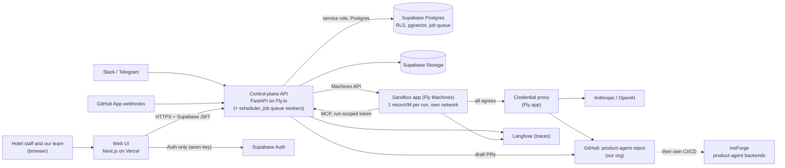

# Infra map — hotel agent harness

One page: what runs where, what talks to what, and where each secret lives. Source of truth for
design: [`architecture.md`](architecture.md). How to deploy: [`runbook-deploy.md`](runbook-deploy.md).
**Status (2026-11-18): nothing is deployed.** Names below are proposals until the owner creates
the accounts (see "Open items" in the runbook). Owner = @nikhilllmno; Bot = the platform-engineer
agent, which writes code and docs but never deploys, migrates, or changes secrets.

## Services

| Service | Runs on | Name per env (staging / prod) | Region | Exists from | Owner (account / code) |
|---|---|---|---|---|---|
| Web UI | Vercel, 2 projects | `vorflux-harness-web-staging` / `vorflux-harness-web` | `iad1` | M1 local, M5 hosted | Owner / Bot |
| Control-plane API (API, scheduler, Postgres-queue workers, connector gateway, MCP server) | Fly.io app | `vorflux-harness-api-staging` / `vorflux-harness-api` | `iad` | M1 local, M5 hosted | Owner / Bot |
| Sandboxes (one Fly Machine per run) | Fly.io app, custom private network | `vorflux-harness-sandbox-staging` / `vorflux-harness-sandbox` | `iad` | M2 | Owner / Bot |
| Credential (egress) proxy | Fly.io app, reachable only from sandboxes | `vorflux-harness-egress-staging` / `vorflux-harness-egress` | `iad` | M2 | Owner / Bot |
| Database, Auth, Storage, job queue | Supabase, 2 projects | `vorflux-harness-staging` / `vorflux-harness-prod` | `us-east-1` | M1 (local stack), M5 hosted | Owner / Bot (migration files) |
| LLM tracing | Langfuse Cloud (or self-hosted, Q5) | one project per env | US | M1 | Owner / Bot |
| GitHub App (draft PRs) | GitHub, our org | `vorflux-harness-staging` / `vorflux-harness` | n/a | M2 | Owner / Bot |
| Product-agent backends | InsForge (not the harness) | per hotel | per hotel | exists | Hotel repo owners |
| CI | GitHub Actions in this repo | n/a | n/a | now | Owner / Bot |

## Environments

| Env | Web | API | Sandboxes | Data | Deploys by |
|---|---|---|---|---|---|
| local | `npm run dev` (:3000) | `uv run harness` (:8000) | Docker (`SANDBOX_PROVIDER=docker_local`) | `supabase start` (local stack) | the developer |
| staging | Vercel staging project | `backend/fly.toml` | Fly sandbox app (staging) | Supabase staging project | a human, owner-approved |
| prod | Vercel prod project | `backend/fly.production.toml` | Fly sandbox app (prod) | Supabase prod project | a human, owner-approved |

## Secrets by name (values never in git)

| Lives in | Names | Notes |
|---|---|---|
| Fly secrets, API app | `SUPABASE_URL`, `SUPABASE_SERVICE_ROLE_KEY`, `SUPABASE_DB_URL`, `SUPABASE_JWT_ISSUER`, `LANGFUSE_BASE_URL`, `LANGFUSE_PUBLIC_KEY`, `LANGFUSE_SECRET_KEY`, `FLY_API_TOKEN`, `FLY_SANDBOX_APP`, `GITHUB_APP_ID`, `GITHUB_APP_PRIVATE_KEY`, `GITHUB_APP_WEBHOOK_SECRET`, `SLACK_BOT_TOKEN`, `SLACK_SIGNING_SECRET`, `TELEGRAM_BOT_TOKEN`, `TELEGRAM_WEBHOOK_SECRET`, `INSFORGE_BASE_URL`, `INSFORGE_API_KEY`, `HARNESS_KMS_KEY_ID` | `FLY_API_TOKEN` is a deploy token scoped to the sandbox app only. |
| Fly `[env]` in `fly*.toml` (not secret) | `HARNESS_ENVIRONMENT`, `HARNESS_LOG_LEVEL`, `HARNESS_CORS_ORIGINS`, `PORT` | CI fails if a secret-like name appears here. |
| Fly secrets, egress proxy app | `ANTHROPIC_API_KEY`, `OPENAI_API_KEY`, `LANGFUSE_PUBLIC_KEY`, `LANGFUSE_SECRET_KEY` | Injected per allowlisted host; sandboxes never see them. |
| Sandbox machine env | `OPENCODE_SERVER_USERNAME`, `OPENCODE_SERVER_PASSWORD` | Generated per run, never stored. No long-lived secret. |
| Vercel env (per project) | `NEXT_PUBLIC_HARNESS_API_URL`, `NEXT_PUBLIC_SUPABASE_URL`, `NEXT_PUBLIC_SUPABASE_ANON_KEY` | Public by design (RLS protects data). No server secrets in Vercel today. |
| Supabase (Postgres rows) | per-org and per-hotel tenant secrets | Envelope-encrypted with `HARNESS_KMS_KEY_ID`. |
| GitHub Actions secrets | `FLY_API_TOKEN_CI_READONLY` (optional) | Read-only; only for `flyctl config validate`. CI never deploys. |
| Operator password manager | `FLY_API_TOKEN` (personal/deploy), `VERCEL_TOKEN`, `VERCEL_ORG_ID`, `VERCEL_PROJECT_ID`, `SUPABASE_ACCESS_TOKEN`, `SUPABASE_DB_PASSWORD` | Used from a human's machine for approved deploys and migrations. |

## Data stores

| Store | Holds | Tenant guard | Backup |
|---|---|---|---|
| Supabase Postgres | all harness data: orgs, hotels, sessions, runs, memory, skills, jobs (Postgres queue), approvals, audit, pgvector | `org_id`/`hotel_id` + RLS | Supabase daily backups; PITR on prod (paid add-on) |
| Supabase Storage | artefacts, skill files, exports (`org/<org_id>/hotel/<hotel_id>/...`) | bucket policies | **none yet**: database backups and PITR keep only object metadata, not the files. Object backup is an open item (runbook O10). |
| Fly volumes (sandbox app) | workspace snapshots per session | one volume per session | none (rebuildable from git) |
| Fly registry `registry.fly.io` | API, sandbox, and proxy images | n/a | keep last 10 releases |
| Langfuse | traces with prompts and outputs (redacted) | project per env, `org_id`/`hotel_id` tags | provider |
| GitHub | code; `harness/*` branches and draft PRs | per-hotel repo allowlist | GitHub |
