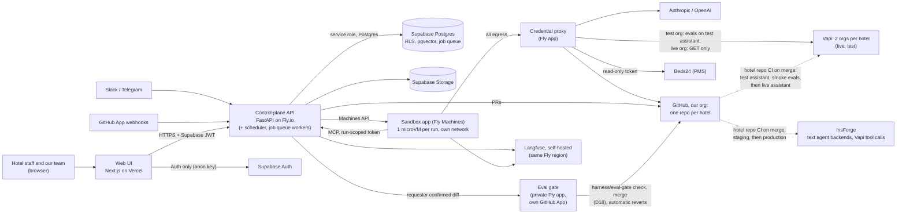

# Infra map — hotel agent harness

One page: what runs where, what talks to what, and where each secret lives. Source of truth for
design: [`architecture.md`](architecture.md). How to deploy: [`runbook-deploy.md`](runbook-deploy.md).
**Status (2026-11-18): nothing is deployed.** Names below are proposals until the owner creates
the accounts (see "Open items" in the runbook). Owner = @nikhilllmno; Bot = the platform-engineer
agent, which writes code and docs but never deploys, migrates, or changes secrets.

## Services

| Service | Runs on | Name per env (staging / prod) | Region | Exists from | Owner (account / code) |
|---|---|---|---|---|---|
| Web UI | Vercel, 2 projects | `vorflux-harness-web-staging` / `vorflux-harness-web` | `bom1` | M1 local, M5 hosted | Owner / Bot |
| Control-plane API (API, scheduler, Postgres-queue workers, connector gateway, MCP server) | Fly.io app | `vorflux-harness-api-staging` / `vorflux-harness-api` | `sin` (`bom` if offered) | M1 local, M5 hosted | Owner / Bot |
| Sandboxes (one Fly Machine per run) | Fly.io app, custom private network | `vorflux-harness-sandbox-staging` / `vorflux-harness-sandbox` | `sin` (`bom` if offered) | M2 | Owner / Bot |
| Credential (egress) proxy | Fly.io app, reachable only from sandboxes | `vorflux-harness-egress-staging` / `vorflux-harness-egress` | `sin` (`bom` if offered) | M2 | Owner / Bot |
| Database, Auth, Storage, job queue | Supabase, 2 projects | `vorflux-harness-staging` / `vorflux-harness-prod` | `ap-south-1` (Mumbai) | M1 (local stack), M5 hosted | Owner / Bot (migration files) |
| LLM tracing | Langfuse, **self-hosted in the pilot region** (default, D25). Langfuse Cloud, which stores data outside India, only if the owner accepts it: **pending** (architecture Q33; runbook O6) | one instance per env: `vorflux-langfuse-staging` / `vorflux-langfuse` | same as Fly (`sin` or `bom`) | M1 local, M5 hosted | Owner / Bot |
| Main harness GitHub App (change-request service: `harness/*` branches, PRs) | GitHub, our org. Contents write, pull requests write, checks read (PR status and check evidence), metadata read. No checks write, no merge path, no administration, no workflow write | `vorflux-harness-staging` / `vorflux-harness` | n/a | M2 | Owner / Bot |
| Eval gate: posts `harness/eval-gate` and merges PRs that pass D18, plus automatic reverts. Kill switch: scale to zero, or a per-hotel pause flag | Separate Fly.io app, private network only, called by the API | `vorflux-harness-eval-gate-staging` / `vorflux-harness-eval-gate` | `sin` (`bom` if offered) | M2 (code changes from M3); hosted M5 | Owner / Bot |
| Eval-gate GitHub App (the only merge credential) | GitHub, our org. Contents write (merge), pull requests write, checks write (`harness/eval-gate`), metadata read. No administration, no workflow write, no bypass | `vorflux-eval-gate-staging` / `vorflux-eval-gate` | n/a | M2 | Owner / Bot |
| Hotel repos (one per hotel; Vapi config in `vapi/`) | GitHub, our org; own CI pushes Vapi config on merge | `<org>/hotel-<slug>` (O12) | n/a | exist; onboarding automation M4 | Owner / our team |
| Voice platform | Vapi (hosted). **Two Vapi orgs per hotel** (D21, Q30): live org (production assistant) and test org (test assistant). A test key never changes a live assistant | `<slug>-live` / `<slug>-test` orgs | Vapi's region (outside India) | M3 (evals, read tools) | Owner / hotel repo CI |
| PMS: Beds24 (first PMS, Q21) | Beds24 cloud. Read-only connector through the credential proxy; evals use a fake Beds24 | per hotel (Beds24 account) | Beds24's region | M3 (read); writes as approved operations in M4 | Hotel / Bot (connector) |
| Text agent backends | InsForge (not the harness) | per hotel | per hotel | exists | Hotel repo owners |
| CI | GitHub Actions in this repo | n/a | n/a | now | Owner / Bot |

**What the eval gate merges (architecture D18, 9.6, 9.9).** Every change class (content, prompt,
config, and backend code) goes live when CI, gitleaks, tests, and all evals pass with no score drop
against `main`, the diff limits hold, and the requester confirmed the readable diff of that exact
commit. Backend code merges through the gate only from M3, when staged rollout, post-deploy smoke
evals, and automatic revert work; until then our team reviews it. A PR always goes to our team if
it changes a protected path (Q28: `harness.yaml`, CODEOWNERS, CI, evals, migrations, payments,
auth) or if `ReviewChange` rates it `High` (Q29). How hotel-repo branch protection allows exactly
this is an **open M2 spike** (O13, architecture 9.3).

## Regions (architecture D25)

The pilot runs in India. Supabase `ap-south-1` (Mumbai) holds all harness data.

- **Fly** (API, eval gate, sandboxes, proxy, Langfuse): `bom` if `fly platform regions` lists it at
  staging setup, else `sin` (Singapore). Fly's region list on 2026-11-18 does not show `bom`, so
  the config files say `sin` (runbook F1a).
- **Vercel** web functions: `bom1` (Mumbai). It is the nearest Vercel region to the data: it is
  in AWS `ap-south-1`, the same region as Supabase. Server-side auth and session calls stay in
  India. If Fly gets `bom`, every part runs in Mumbai.
- **Outside India:** Vapi (calls, transcripts, recordings) and the model providers (Anthropic,
  OpenAI) process data in their own regions. The redaction step limits what the model providers
  see. Langfuse Cloud would also be outside India (pending, Q33; runbook O6). Region per org comes in M6.

## Environments

| Env | Web | API | Sandboxes | Data | Deploys by |
|---|---|---|---|---|---|
| local | `npm run dev` (:3000) | `uv run harness` (:8000) | Docker (`SANDBOX_PROVIDER=docker_local`) | `supabase start` (local stack) | the developer |
| staging | Vercel staging project | `backend/fly.toml` | Fly sandbox app (staging) | Supabase staging project | a human, owner-approved |
| prod | Vercel prod project | `backend/fly.production.toml` | Fly sandbox app (prod) | Supabase prod project | a human, owner-approved |

## Secrets by name (values never in git)

| Lives in | Names | Notes |
|---|---|---|
| Fly secrets, API app | `SUPABASE_URL`, `SUPABASE_SERVICE_ROLE_KEY`, `SUPABASE_DB_URL`, `SUPABASE_JWT_ISSUER`, `LANGFUSE_BASE_URL`, `LANGFUSE_PUBLIC_KEY`, `LANGFUSE_SECRET_KEY`, `FLY_API_TOKEN`, `FLY_SANDBOX_APP`, `GITHUB_APP_ID`, `GITHUB_APP_PRIVATE_KEY`, `GITHUB_APP_WEBHOOK_SECRET`, `SLACK_BOT_TOKEN`, `SLACK_SIGNING_SECRET`, `TELEGRAM_BOT_TOKEN`, `TELEGRAM_WEBHOOK_SECRET`, `INSFORGE_BASE_URL`, `INSFORGE_API_KEY`, `HARNESS_KMS_KEY_ID`, `EVAL_GATE_API_TOKEN` | `FLY_API_TOKEN` is a deploy token scoped to the sandbox app only. |
| Fly `[env]` in `fly*.toml` (not secret) | `HARNESS_ENVIRONMENT`, `HARNESS_LOG_LEVEL`, `HARNESS_CORS_ORIGINS`, `PORT` | CI fails if a secret-like name appears here. |
| Fly secrets, egress proxy app | `ANTHROPIC_API_KEY`, `OPENAI_API_KEY`, `LANGFUSE_PUBLIC_KEY`, `LANGFUSE_SECRET_KEY` | Injected per allowlisted host; sandboxes never see them. |
| Fly secrets, Langfuse app (self-hosted) | `DATABASE_URL`, `NEXTAUTH_SECRET`, `NEXTAUTH_URL`, `SALT`, `ENCRYPTION_KEY`, `CLICKHOUSE_URL`, `CLICKHOUSE_USER`, `CLICKHOUSE_PASSWORD`, `REDIS_CONNECTION_STRING`, `LANGFUSE_S3_EVENT_UPLOAD_BUCKET` and its access keys | Langfuse's own server settings; all its stores stay in the pilot region. Never change `SALT` or `ENCRYPTION_KEY` after first start. |
| Vercel env (per project) | `NEXT_PUBLIC_HARNESS_API_URL`, `NEXT_PUBLIC_SUPABASE_URL`, `NEXT_PUBLIC_SUPABASE_ANON_KEY` | Public by design (RLS protects data). No server secrets in Vercel today. |
| Supabase (Postgres rows) | per-org and per-hotel tenant secrets | Envelope-encrypted with `HARNESS_KMS_KEY_ID`. |
| Fly secrets, eval-gate app | `EVAL_GATE_GITHUB_APP_ID`, `EVAL_GATE_GITHUB_APP_PRIVATE_KEY`, `EVAL_GATE_DB_URL`, `EVAL_GATE_API_TOKEN` | The only merge credential. `EVAL_GATE_DB_URL` uses a narrow Postgres role: it reads confirmations and per-hotel pause flags and writes merge records. `EVAL_GATE_API_TOKEN` is also on the API app. |
| Supabase rows, per hotel (Vapi) | `VAPI_TEST_PRIVATE_API_KEY` (test org), `VAPI_READ_PRIVATE_API_KEY` (live org) | The proxy injects them for `api.vapi.ai`. A Vapi private key reaches every assistant in its org, so the test key lives in a separate org and can never change a live assistant. The proxy allows only `GET` with the live-org key. |
| Supabase rows, per hotel (Beds24) | `BEDS24_READ_TOKEN` | A Beds24 long-life token with `read/...` scopes only (Beds24 enforces read-only). The proxy injects it for `beds24.com/api/v2`. The fake Beds24 for evals needs no secret. |
| Hotel repo, GitHub environment `vapi-production` (branch `main` only) | secret `VAPI_PRIVATE_API_KEY` (live org); variable `VAPI_ASSISTANT_ID` | Used only by the push-on-merge job. The only key that can change the live assistant. |
| Hotel repo, GitHub environment `vapi-test` | secret `VAPI_TEST_PRIVATE_API_KEY`; variable `VAPI_TEST_ASSISTANT_ID` | Evals on PRs and the staged-rollout step. Test org only, so PR code cannot reach production. |
| Hotel backend env and Vapi | `VAPI_SERVER_SECRET` | Signs Vapi tool calls. Never in `vapi/assistant.yaml`. |
| GitHub Actions secrets (this repo) | `FLY_API_TOKEN_CI_READONLY` (optional) | Read-only; only for `flyctl config validate`. CI never deploys. |
| Operator password manager | `FLY_API_TOKEN` (personal/deploy), `VERCEL_TOKEN`, `VERCEL_ORG_ID`, `VERCEL_PROJECT_ID`, `SUPABASE_ACCESS_TOKEN`, `SUPABASE_DB_PASSWORD` | Used from a human's machine for approved deploys and migrations. |

## Data stores

| Store | Holds | Tenant guard | Backup |
|---|---|---|---|
| Supabase Postgres | all harness data: orgs, hotels, sessions, runs, memory, skills, jobs (Postgres queue), approvals, audit, pgvector | `org_id`/`hotel_id` + RLS | Supabase daily backups; PITR on prod (paid add-on) |
| Supabase Storage | artefacts, skill files, exports (`org/<org_id>/hotel/<hotel_id>/...`) | bucket policies | **none yet**: database backups and PITR keep only object metadata, not the files. Object backup is an open item (runbook O10). |
| Fly volumes (sandbox app) | workspace snapshots per session | one volume per session | none (rebuildable from git) |
| Fly registry `registry.fly.io` | API, sandbox, and proxy images | n/a | keep last 10 releases |
| Langfuse (self-hosted) | traces with prompts and outputs (redacted), in its Postgres, ClickHouse, and S3-compatible store | project per env, `org_id`/`hotel_id` tags | its own Postgres backups; open with O10 |
| GitHub | code; `harness/*` branches and PRs | per-hotel repo allowlist | GitHub |
| Vapi | live assistant config (copy of `main`), call logs | two orgs per hotel, live and test (D21) | none; git is the source, and the push job keeps the last live config as a workflow artifact |
